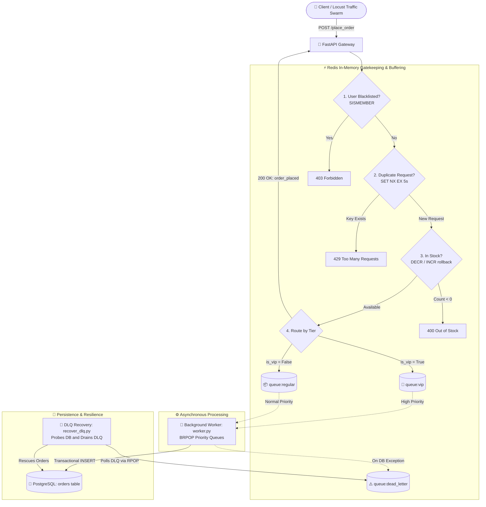

# ⚡ Peak Order System — High-Throughput & Fault-Tolerant Order Ingestion Engine

[](https://www.python.org/)
[](https://fastapi.tiangolo.com/)
[](https://redis.io/)
[](https://www.postgresql.org/)
[](https://locust.io/)
[](https://www.docker.com/)

A distributed, asynchronous, and fault-tolerant backend system engineered to withstand sudden traffic avalanches (flash sales, peak-hour meal rushes, concert drops) without database connection exhaustion, race conditions, or order loss.

---

## 📌 The Problem & Solution

### The Flash-Sale Dilemma
In traditional monolithic architectures, incoming order requests directly perform synchronous transactional writes (`INSERT`, `SELECT FOR UPDATE`) against a relational database. Under flash-sale conditions:
* Hundreds of concurrent transactions saturate the PostgreSQL connection pool.
* Heavy row-level locking on inventory tables causes cascading lock contention and thread starvation.
* Sudden request spikes trigger latency spikes, connection timeouts, and database server crashes, leading to lost revenue and angry customers.

### The Peak-Order Solution
**Peak Order System** decouples **order ingestion** from **database persistence** using an in-memory cache-first architecture:
1. **Sub-millisecond Ingestion:** The FastAPI gateway offloads all high-frequency operations (blacklist checks, request deduplication, atomic inventory tracking) to in-memory Redis data structures.
2. **Traffic Leveling (Rate Absorber):** Orders are pushed to prioritized Redis queues, immediately returning a receipt to the client.
3. **Controlled Persistence:** Dedicated background workers drain the queues and write to PostgreSQL at a sustainable, governed ingestion rate.
4. **Zero Data Loss (Self-Healing DLQ):** If the primary database fails or becomes unreachable, orders are routed to a Dead Letter Queue (DLQ) and automatically drained and rescued once the database recovers.

---

## 🏗️ System Architecture & Workflow



---

## 🎯 Key Engineering Highlights

### 1. Atomic Concurrency Control (Zero Overselling)
Handling inventory in PostgreSQL with `SELECT ... FOR UPDATE` causes severe row lock contention under concurrent load. Peak Order leverages Redis's single-threaded atomic command execution:
```python
item_left = redis_client.decr(inventory_key)
if item_left < 0:
    redis_client.incr(inventory_key)  # Compensating rollback transaction
    raise HTTPException(status_code=400, detail="item out of stock")
```
No two requests can decrement the same unit twice, guaranteeing physical impossibility of overselling with $O(1)$ latency.

### 2. Distributed Idempotency Lock
To protect against user double-taps, network retries, and automated bot scripts:
* Computes a SHA-256 fingerprint from the serialized JSON payload.
* Applies a Redis lock using atomic key acquisition with a 5-second TTL:
  ```python
  is_new_request = redis_client.set(idempotency_key, "locked", nx=True, ex=5)
  ```
* Duplicate submissions within the window are rejected with `HTTP 429 Too Many Requests`.

### 3. Strict Quality of Service (QoS) Priority Queuing
VIP customers receive expedited processing during peak loads. Instead of complex multi-broker sorting, the worker utilizes Redis's native `BRPOP` left-to-right evaluation:
```python
result = redis_client.brpop(["queue:vip", "queue:regular"], timeout=1)
```
As long as `queue:vip` has pending items, the worker will **never** touch `queue:regular`, ensuring low SLA guarantees for high-value orders.

### 4. Dead Letter Queue (DLQ) & Self-Healing Event Replay
Network partitions or database crashes do not result in dropped orders:
* If PostgreSQL rejects a write, the worker executes `db.rollback()` and deposits the order into `queue:dead_letter`.
* A background recovery agent ([recover_dlq.py](app/recover_dlq.py)) periodically health-checks PostgreSQL (`SELECT 1`).
* Once the database recovers, it drains the DLQ in FIFO order and commits the rescued orders to disk.

---

## 📊 Stress & Load Testing Benchmark (Locust)

The system was subjected to sustained high-concurrency traffic simulation using **Locust** on local hardware:

### Test Configuration
* **Total Simulated Users:** 100 concurrent users
* **Spawn Rate:** 10 users/second
* **User Wait Time:** 100ms – 500ms (hyper-rapid clicking)
* **Payload Scope:** Dynamic randomization across 4 menu items, prices, user IDs, and VIP statuses.

### Benchmark Results
| Metric | Result | Engineering Impact |
|:---|:---|:---|
| **Total Requests Handled** | **23,688** | High volume processed without memory leaks or crashes |
| **Peak Throughput** | **153.9 RPS** | **~554,000 orders/hour** capacity on local commodity hardware |
| **Median Latency (p50)** | **290 ms** | Consistent sub-300ms response time under peak pressure |
| **90th Percentile (p90)** | **400 ms** | Tight latency curve with minimal queuing drift |
| **99th Percentile (p99)** | **530 ms** | Minimal tail latency under full concurrency |
| **Min / Max Latency** | **13 ms / 857 ms** | Fast paths executed in low double-digit ms |
| **Total Failure Rate** | **0.05%** (12 / 23,688) | **Zero database crashes**. All 12 rejections were `HTTP 429` locks protecting the gateway |

---

## 📂 Project Structure

```plaintext
peak-order-system/
├── app/
│   ├── database.py       # PostgreSQL connection engine & session factory
│   ├── locustfile.py     # Locust load testing swarm configuration
│   ├── main.py           # FastAPI gateway (Validation, Redis gates, Queueing)
│   ├── models.py         # SQLAlchemy ORM database models (User, Order)
│   ├── recover_dlq.py    # Self-healing DLQ recovery cron process
│   └── worker.py         # Asynchronous consumer inserting orders into PostgreSQL
├── docker-compose.yml    # Container definitions for PostgreSQL 15 & Redis 7
├── Dockerfile            # Container build recipe for FastAPI API
├── requirements.txt      # Pinned project dependencies
└── README.md             # Architecture documentation
```

---

## 🛠️ Tech Stack

| Component | Technology | Rationale |
|:---|:---|:---|
| **API Framework** | **FastAPI** | High-performance asynchronous REST routing, OpenAPI generation, and Pydantic validation. |
| **Cache & Queue** | **Redis** | In-memory atomic data structures for sub-millisecond locks, rate limits, and priority queues. |
| **Database** | **PostgreSQL 15** | ACID-compliant relational persistence for confirmed order records. |
| **ORM / Query Engine**| **SQLAlchemy** | Declarative schema management and connection pooling. |
| **Load Testing** | **Locust** | Python-based load testing simulating realistic concurrent user behavior. |
| **Containerization** | **Docker & Docker Compose** | Reproducible multi-service local environment. |

---

## 🚀 Setup & Execution Guide

### 1. Prerequisites
* [Docker Desktop](https://www.docker.com/) installed and running.
* Python 3.10+ installed.

### 2. Clone and Setup Environment
```bash
git clone https://github.com/<your-username>/peak-order-system.git
cd peak-order-system

# Create and activate virtual environment
python -m venv .venv
# On Windows (PowerShell):
.venv\Scripts\activate
# On Linux/macOS:
source .venv/bin/activate

# Install dependencies
pip install -r requirements.txt
```

### 3. Start Database & Redis via Docker
```bash
docker-compose up -d
```
> PostgreSQL will start on host port `5433` (mapped from container `5432`) and Redis on host port `6379`.

### 4. Seed Redis (Initial Inventory & Blacklist)
Before placing orders, pre-populate the stock in Redis using this one-liner:
```bash
python -c "import redis; r = redis.Redis(host='localhost', port=6379, decode_responses=True); r.set('inventory:Chicken Biryani', 100000); r.set('inventory:Butter Paneer', 50000); r.set('inventory:Garlic Naan', 80000); r.set('inventory:Diet Coke', 100000); r.sadd('blacklist:users', 999999)"
```
*(User ID `999999` is blacklisted for verification).*

### 5. Run the System Services
Open 3 separate terminal tabs:

* **Terminal 1: Start API Gateway**
  ```bash
  uvicorn app.main:app --host 0.0.0.0 --port 8000 --reload
  ```
  *Interactive Swagger API documentation available at: `http://localhost:8000/docs`*

* **Terminal 2: Start Background Worker**
  ```bash
  python -m app.worker
  ```

* **Terminal 3: Start DLQ Recovery Cron**
  ```bash
  python -m app.recover_dlq
  ```

---

## 🧪 Running the Load Test (Locust)

1. With all 3 services running, launch Locust in a new terminal:
   ```bash
   locust -f app/locustfile.py
   ```
2. Open your browser and navigate to **`http://localhost:8089`**.
3. Configure the test parameters:
   * **Number of users:** `100`
   * **Spawn rate:** `10`
   * **Host:** `http://127.0.0.1:8000`
4. Click **Start swarming** and observe real-time throughput and latency curves!

---

## 📖 API Specification

### Place Order
`POST /place_order`

#### Request Body
```json
{
  "user_id": 1042,
  "item_name": "Chicken Biryani",
  "price": 250.0,
  "is_vip": true
}
```

#### Responses
| Code | Meaning | Reason |
|:---|:---|:---|
| `200 OK` | `{"message": "order_placed"}` | Valid request; inventory decremented and pushed to queue. |
| `400 Bad Request` | `{"detail": "item out of stock"}` | Inventory in Redis reached `<= 0`. Decrement was rolled back. |
| `403 Forbidden` | `{"detail": "User blacklisted"}` | User ID exists in `blacklist:users` Redis Set. |
| `429 Too Many Requests` | `{"detail": "double order"}` | Duplicate request payload submitted within 5-second window. |

---

## 💡 Production Trade-offs & Future Enhancements

* **Redis Streams vs Redis Lists:** Migrating from `LPUSH`/`BRPOP` to Redis Streams (`XADD`, `XREADGROUP`) would provide consumer acknowledgement (`XACK`), replay offsets, and multi-consumer load balancing.
* **Asynchronous Database Driver:** Upgrading SQLAlchemy to use `asyncpg` and running `redis.asyncio` natively inside FastAPI's async event loop to eliminate thread-pool switching overhead.
* **Containerized Worker & Dynamic Scaling:** Incorporating the worker and DLQ recovery scripts as services within `docker-compose.yml` and configuring autoscaling worker replicas with Celery or Kubernetes KEDA based on Redis queue depth.
